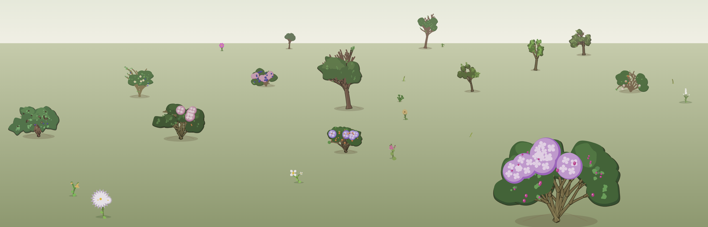
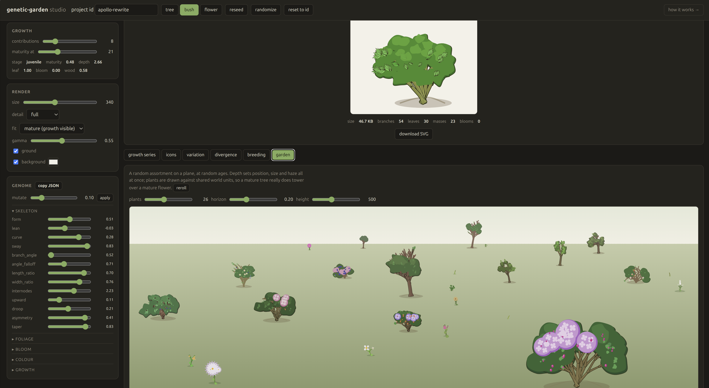

# genetic-garden

Procedural 2D plants for a project garden. Every project gets one plant,
derived from its id, that grows as the project accumulates contributions.

Three kingdoms — **tree**, **bush**, **flower** — designed to be
distinguishable at a glance and still legible at 16px. Pure Python, no
dependencies, SVG out.

Stdlib-only on Python 3.9+, so it runs in whatever environment the site
build already uses — nothing to install. `environment.yml` is optional and
covers only the extras (`cairosvg` if you want PNGs, `pytest` for nicer
test output).



```
seed → sprout → seedling → juvenile → maturing → mature
```

## Install

```bash
pip install git+https://github.com/Maqz-Bromberg/genetic-garden.git
# or, with Poetry:
poetry add git+https://github.com/Maqz-Bromberg/genetic-garden.git
```

Or just clone it and run `python -m genetic_garden ...` — no install needed.
Optional PNG output: `pip install "genetic-garden[png]"`.

## Quick start

```python
from genetic_garden import Plant

p = Plant.from_id("apollo-rewrite", "tree")   # kingdom optional

p.svg(contributions=8)              # 256px illustration
p.icon(contributions=8, size=24)    # list-header icon
p.stage(8)                          # "maturing"
```

The id seeds everything, so a project always grows the same plant. Omit the
kingdom and it is drawn from the id too.

```bash
python -m genetic_garden serve                             # interactive studio
python -m genetic_garden render apollo -k tree -n 8 -o apollo.svg
python -m genetic_garden series apollo -k tree -o out/     # every stage
python -m genetic_garden sheet -o gallery.html             # contact sheet
python -m genetic_garden garden projects.json -o garden/   # per-project files
python -m genetic_garden scene -o garden.svg --count 26    # one garden scene
python -m genetic_garden docs -o genetic_garden/web/docs                  # how-it-works pages
```

## How it works

Seven long-form pages, one per algorithm, live in [`genetic_garden/web/docs/`](genetic_garden/web/docs/)
and are linked from the studio:

```bash
python -m genetic_garden docs -o genetic_garden/web/docs
```

| | |
|---|---|
| [Genomes](genetic_garden/web/docs/genome.html) | an id becomes a plant, and the same plant every time |
| [Growth](genetic_garden/web/docs/growth.html) | contributions become a maturity profile |
| [The skeleton](genetic_garden/web/docs/skeleton.html) | three growth rules, a walk with forces, and draw order |
| [Organs](genetic_garden/web/docs/organs.html) | one function for every blade; blooms sampled from archetypes |
| [Colour](genetic_garden/web/docs/palette.html) | HSL anchors, hue bands, and the tone gap that matters |
| [Rendering](genetic_garden/web/docs/render.html) | layers, scale-aware detail, and what not to draw |
| [The garden scene](genetic_garden/web/docs/garden.html) | depth, world scale, painter's order |

**Every figure is generated by the code it describes** — the real
`_trace`, the real blade function, the real palette — rather than drawn to
resemble it. A diagram made from the implementation cannot drift away from
it, and when a constant changes the picture changes with it. Figures use
semantic CSS classes rather than literal colours, so one SVG reads
correctly on a light or a dark page.

`tools/preview_figs.py` renders every figure onto one page for eyeballing,
and `tools/shot_svg.py` screenshots SVGs through Chromium for the things
ImageMagick's renderer cannot draw (gradients, most obviously).

## The studio



```bash
python -m genetic_garden serve          # http://127.0.0.1:8753
```

A local, dependency-free dev server (`server.py` + `genetic_garden/web/`) for looking at
plants while you tune the algorithm. All drawing happens in Python and the
page only posts parameters and drops the returned SVG in, so what you see
is exactly what the build pipeline emits.

* **Gene sliders**, grouped, live. Each shows the expressed trait value
  next to the raw gene, so you can see what `branch_angle = 0.62` actually
  means for a bush.
* **Contributions slider**, with the growth profile (maturity, depth,
  leafiness, bloom, woodiness) read out beside it. Drag it and watch the
  plant grow.
* **Kingdom switch keeps the chromosome**, so you can look at one genome
  expressed as a tree, a bush and a flower and see the family resemblance.
* **Growth series, icons, variation, divergence, breeding, garden** as
  tabs. Clicking a variant or a bred child loads its genome into the editor.
* Render controls for size, detail, fit and gamma, plus path/branch/leaf
  counts and the byte size of the current SVG — useful when you are
  trading detail against file size.

A main render is ~60ms, so slider dragging is responsive; whole panels are
debounced.

`tools/studio_smoke.py` drives the whole page in a real browser — every
control, every tab, three viewport widths — and fails on any console error,
page error or layout overflow. It also writes a screenshot per tab, which
is the only way to check the page actually looks right:

```bash
pip install playwright && python -m playwright install chromium
python tools/studio_smoke.py --shots shots/
```

Endpoints, if you want to drive it from something else:

| | |
|---|---|
| `GET /api/meta` | kingdoms, gene groups, expressed ranges, stage names |
| `POST /api/render` | one genome in, every view out (`include` picks sections) |
| `POST /api/breed` | cross two ids, optionally mutate, return the child |

For a static artefact rather than a live page, `sheet` renders growth
series, cross-genome variation, mutation divergence and icons onto one
self-contained HTML file. Either way, visual quality is a matter of taste
and has to be checked by eye.

## How it works

Five stages, each a module, each ignorant of the next:

```
genome.py    id ──hash──> genes (floats in [0,1]) ──> traits
growth.py    contributions ──> maturity profile
skeleton.py  genome + growth ──> branch polylines + organ sites
organs.py    leaves, petals, blooms as path geometry
render.py    skeleton + palette ──> SVG
```

### Genome

A genome is a dict of floats in `[0, 1]`. Nothing in the chromosome knows
about plants — expression happens in `traits()`, which maps each gene
through a per-kingdom range. Two consequences:

* crossover and mutation can never produce an invalid plant, and
* the same chromosome expressed as a tree and as a flower gives two plants
  with a visible family resemblance — same lean, same branch rhythm, same
  hue shift.

Randomness during construction is *addressed*, not streamed: each branch
derives its own RNG from its position in the tree (`"0.2.1"`). Growing a
plant one level deeper therefore never reshuffles the branches that were
already there.

### Growth

One number (`Growth.value`, 0..1) drives everything, read through a
per-kingdom schedule. Contributions map onto it logarithmically, so the
first few contributions visibly move the needle and later ones refine.

The constraint that shapes the whole design: **growth must never reshuffle
the plant.** The genome fixes the individual; growth only extends it. So
recursion depth is deliberately *fractional* — the newest level of branches
emerges scaled-down from its parent tips rather than popping into
existence, and consecutive contributions read as the same plant getting
bigger.

### The three kingdoms

| | structure | foliage | bloom |
|---|---|---|---|
| **tree** | one dominant trunk, branching starts high, laterals plus a continuing leader | simple, compound or needle | scattered blossom, or a whole crown of it |
| **bush** | no trunk at all — several stems from ground level, wide repeated forks | simple, palmate or needle | scattered, or big hydrangea trusses |
| **flower** | one slender stem, few but large leaves, basal rosette | simple or palmate | one of six archetypes, the subject of the drawing |

A `form` gene sets overall habit (columnar↔spreading for a tree,
upright↔mounding for a bush). It is worth more to how distinct two plants
look than any other gene, because it acts on the recursion rather than on a
single feature.

### A step above stick figures

The things doing the work, roughly in order of how much they matter:

* **Tapered, curved branches.** Three forces bend every branch as it is
  traced: a constant per-branch curvature (its "handwriting"),
  phototropism pulling toward vertical, and gravity pulling thin branches
  back down. Spines become filled outlines with a lit edge on whichever
  flank faces the light.
* **Foliage masses, not individual leaves.** Clusters of branch tips are
  snapped to a grid and fitted with soft blobs, drawn in three passes — a
  dark shell offset away from the light, the body, then a lit cap. Drawn
  leaves sit *on top* and break the edge, which is what stops a crown
  looking like broccoli. It is also what survives downscaling.
* **One parametric blade.** Every leaf, cotyledon, petal, sepal and bud is
  `half_width(u) = w · sin(π·u^e) · (1 − tooth·triangle(u·n))`. `e` slides
  the widest point from base to tip; `tooth` serrates the margin. One
  function, and the genome picks a leaf out of the whole continuum.
* **Draw order, and branch collars.** `skeleton.branches` is a *draw list*,
  not a bag: limbs passing behind a branch are emitted before it, its own
  continuation after it. Laterals therefore emerge from behind their
  parent, while a leader is drawn over it so the leader's collar covers
  where the parent was cut off. A branch with something continuing from its
  tip stays blunt; only a genuine terminal twig tapers to a point. The
  renderer iterates the list as-is — sorting it puts every trunk's cut tip
  back on top of the limb meant to hide it, and you get a seam across the
  trunk.

  On top of the ordering, a limb *flares* where it leaves its parent (the
  branch collar) and starts from a point behind its origin, inside the
  parent's wood, so the cut end is buried rather than butted on. The same
  flare at ground level gives a trunk its root buttress. A limb that passes
  in *front* of its parent has nothing to hide its buried end, so it gets a
  thin spike instead of a blunt one — a narrow wedge reads as the limb
  emerging, a wide one reads as a seam drawn across the trunk. A leader
  barely flares at all: it is the same axis carrying on, and a full collar
  there makes every trunk joint bulge like a knuckle.
* **Leaf depth.** Leaves scatter through four depth bands on the same
  principle — some lost behind the wood, some in the middle of the foliage,
  some out in front, with tone following depth. A single layer of leaves
  always reads as a decal.
* **Consistent light** from the upper left, on every part, every plant.
* **Botanical colour bands.** Petal hues map into bands real petals occupy
  (warm reds, yellows, pinks, purples) and berries into scarlet/orange/
  damson/sloe. Randomly seeded gardens then still look like gardens rather
  than a colour picker. Flower centres are always amber or brown — the
  contrast is what makes a bloom read at icon size.

### Leaf architecture and grain

Two genes do most of the work in making one plant's foliage unlike
another's.

`leaf_form` picks an architecture: a **simple** blade, a **compound**
frond of leaflets up a rachis, a **palmate** hand, or a **needle** tuft.
Thresholds differ per kingdom, so trees get compound and needle forms while
bushes get palmate and needle. A compound-leaved tree is a different plant
at a glance in a way no amount of recolouring achieves.

The foliage budget is denominated in **blades, not leaves**, so a compound
tree does not cost five times a simple one; instead it gets fewer, larger
fronds, which is also what they look like in life.

`leaf_grain` slides between a few bold leaves — with the canopy masses
carrying the crown — and a haze of tiny ones that carries it itself, with
the masses pulled back. Fine grain costs more paths and simplifies worse at
icon size; that trade is deliberately exposed rather than decided for you.
`crown_open` controls how much woody interior shows through, and primary
limbs are never hidden by foliage, because a crown you cannot see any
structure inside reads as a lollipop.

### Inflorescence archetypes

`bloom_form` samples from a set rather than scaling one shape, because a
bell is not a wide daisy:

| | |
|---|---|
| **daisy** | rounded petals round an amber disc |
| **star** | narrow petals tapering to points (`tip_shift` below 1 puts the widest part near the base) |
| **cross** | four broad petals |
| **pompom** | many narrow petals in two layers over a small centre |
| **bell** | a nodding cup, drawn side-on with a flared mouth — the one organ that needs its own outline, since a blade pinches shut at both ends and can never make a mouth |
| **spike** | a raceme of small florets that opens from the bottom up |

Woody plants choose differently: a bush gets scattered blossom or big
**globe** trusses in the hydrangea manner, sized from the plant's span so a
bush in full bloom really is about a third flower. A tree gets scattered
blossom or, occasionally, **blossom** — the canopy masses themselves take
the petal colour, which is what a crab apple looks like in April.

Every bloom on a flower keeps the plant's archetype, terminal or not; a
campanula does not grow one bell and two daisies. Blossom on a woody plant
is texture over a crown and gets the plain five-petal treatment.

### The garden scene

`scene` strews plants over a plane at random ages — the view the whole
thing is for.

```bash
python -m genetic_garden scene -o garden.svg --count 26 --seed 3
```

Three things carry it, and there is not much else:

* **Depth.** Each plant gets a depth 0..1, which sets how far down the
  frame it stands, how large it is, and how much haze sits over it. That is
  the entire perspective.
* **World scale.** Plants are measured against shared world units rather
  than each fitted to its own box, so a mature tree towers over a mature
  flower. Those units are *measured, not assumed* — everything downstream
  of `_trace` (curvature, gravity, the crown) changes a plant's final
  height, and an assumed figure had flowers drawn taller than the shrubs
  behind them. A mature flower is 0.28 of a mature tree; a bush is 0.49.
* **Painter's order.** Sort by baseline, far first, and near plants overlap
  far ones for nothing.

Plants are spaced by rejection sampling, but only against others at a
*similar depth* — two plants far apart in the plane are meant to overlap.
In a crowded scene some simply never find room and do not grow, which is
why `planted` can come back lower than `count`.

Detail follows on-screen size automatically, and nothing in a scene earns
full detail: veins and per-leaf outlines are invisible at these sizes and a
garden of them runs to megabytes. A 26-plant scene is roughly 400–500KB,
which is fine for a page but worth rasterising if you are shipping many.

### Scale-aware detail

Line weights are specified in **output pixels** and converted into plant
space once the fit scale is known. That one trick lets the same plant
render as a 512px illustration and a 20px icon without twigs vanishing or
outlines turning to mud. On top of it:

* structure below a couple of pixels is **dropped**, not clamped up to a
  visible width (clamping is what turns small renders into a ball of fat
  twigs);
* twigs buried inside the canopy are skipped — invisible, and a third of
  the file;
* coordinate precision follows the render scale;
* paths are grouped by shared fill and stroke, which roughly halves output.

Typical sizes at 256px, fully mature: tree ~56KB median, bush ~74KB,
flower ~15KB. Icons are 1–3KB median and up to ~11KB for the fine-grained,
heavily-flowered extremes.

### Fitting

`Plant.svg(..., fit=...)` picks how the plant is scaled into the frame, and
the choice matters more than it sounds:

* `mature` (default) — scale against this plant's own full-grown size, so a
  seedling sits small in the frame and a mature plant fills it. This is
  what makes growth legible at a glance.
* `world` — shared cross-kingdom units, so a mature tree towers over a
  mature flower. Use for plants sharing one canvas.
* `bbox` — fill the frame at every stage.

`growth_gamma` compresses the `mature` range: 1.0 is honest scaling, which
leaves a sprout too small to recognise. The default is 0.55, and icons use
0.34 so growth still shows at 16px.

## Genetics

```python
a, b = Plant.from_id("apollo", "flower"), Plant.from_id("borealis", "flower")
child = a.cross(b).mutate(rate=0.12, scale=0.10)
```

Mutation is the interesting one. Because most genes feed a *recursive* rule
— branch angle, length ratio, curvature, form — a 0.05 nudge is nearly
invisible on a seedling and obvious on a mature plant: the divergence
compounds once per level of depth, and depth increases with growth. So
sibling plants start alike and grow apart, which is the fractal behaviour
you wanted. There is a test for it
(`test_mutation_diverges_more_on_a_grown_plant`), and the `sheet` command
renders a divergence row.

## Integration

`garden` takes a manifest and writes everything a site needs:

```bash
echo '{"apollo-rewrite": 21, "borealis-api": 8, "cinder-docs": 3}' > projects.json
python -m genetic_garden garden projects.json -o static/garden --size 200
```

produces `apollo-rewrite.svg`, `apollo-rewrite.icon.svg`, … plus
`index.json`:

```json
[{"id": "apollo-rewrite", "kingdom": "flower", "contributions": 21,
  "stage": "mature", "maturity": 1.0,
  "svg": "apollo-rewrite.svg", "icon": "apollo-rewrite.icon.svg"}]
```

Output is deterministic, so regenerating on every build is cheap and the
diff is empty unless a contribution count changed. Genomes can also be
persisted (`Genome.to_json`) and reloaded with `--genome-file` if you ever
want a plant to outlive a change to the gene tables — adding a gene shifts
every genome, since genes are drawn in sorted name order.

## Layout

```
genetic_garden/
  genome.py     genes, trait ranges, breeding, stable seeding
  growth.py     contributions -> maturity profile
  skeleton.py   the three growth rules; branch + organ placement
  organs.py     the parametric blade; leaves, petals, blooms
  palette.py    HSL colour, botanical hue bands
  render.py     SVG emission, scale-aware detail
  plant.py      the front door
  garden.py     scattering many plants over a plane, and composing a scene
  diagrams.py   annotated figures, generated from the real algorithms
  docs.py       the how-it-works pages
  cli.py        serve / render / series / icons / sheet / scene / docs
  server.py     local dev server for the studio
  geometry.py   vectors, splines, tapered outlines, path emission
genetic_garden/web/   the studio page (index.html, app.js, style.css)
genetic_garden/web/docs/       generated explanation pages
tools/preview_figs.py   every documentation figure on one page
tools/studio_smoke.py   browser test for the studio (needs playwright)
tests/test_garden.py
```

```bash
python -m unittest discover -s tests
```

## Tuning

Most visual changes are one constant:

| want | change |
|---|---|
| faster/slower growth | `growth.DEFAULT_FULL`, `growth.CURVE` |
| when each stage starts | `growth._SCHEDULE` |
| denser or sparser crowns | `skeleton.BLADE_BUDGET`, mass `cell` factor in `_add_masses` |
| which leaf architectures occur | thresholds in `organs.leaf_form` |
| which blooms occur | thresholds in `organs.bloom_form` |
| how much wood shows through | `crown_open` range, `render._buried` |
| branch junctions | `COLLAR_FLARE`, `LEADER_FLARE`, `ROOT_DEPTH` in `skeleton` |
| relative plant sizes | the third number in `skeleton._BASE` (measure, don't guess) |
| garden perspective | `garden.NEAR_HEIGHT`, `FAR_HEIGHT`, `horizon` |
| bushier or lankier | `genome.PER_KINGDOM` branch angle / length ratio ranges |
| different palette | `palette._ANCHOR`, `_BLOOM_BANDS`, `_BERRY_BANDS` |
| smaller files | `render.style_for` thresholds |

## License

[MIT](LICENSE)
